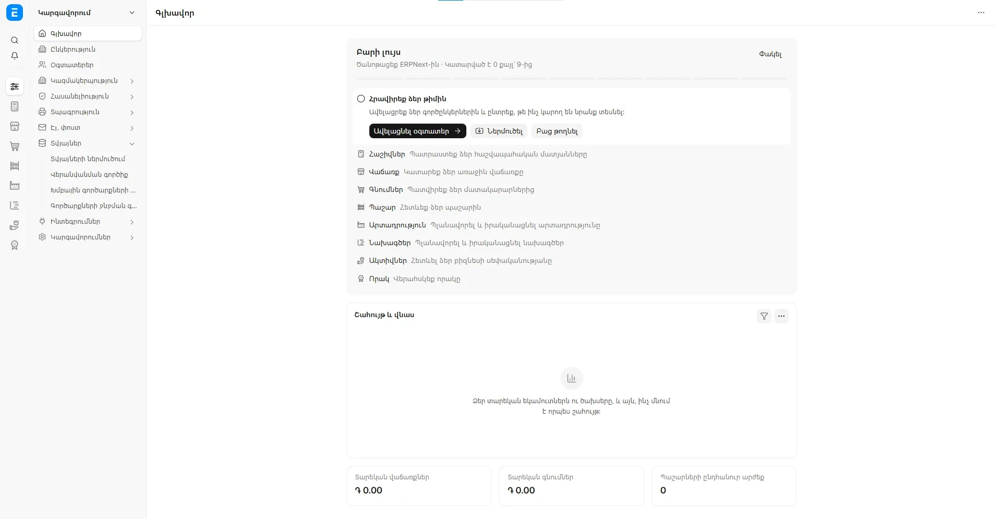
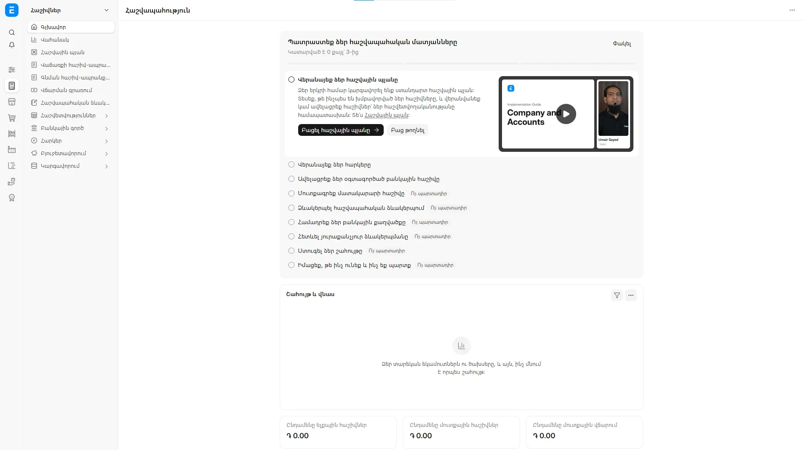
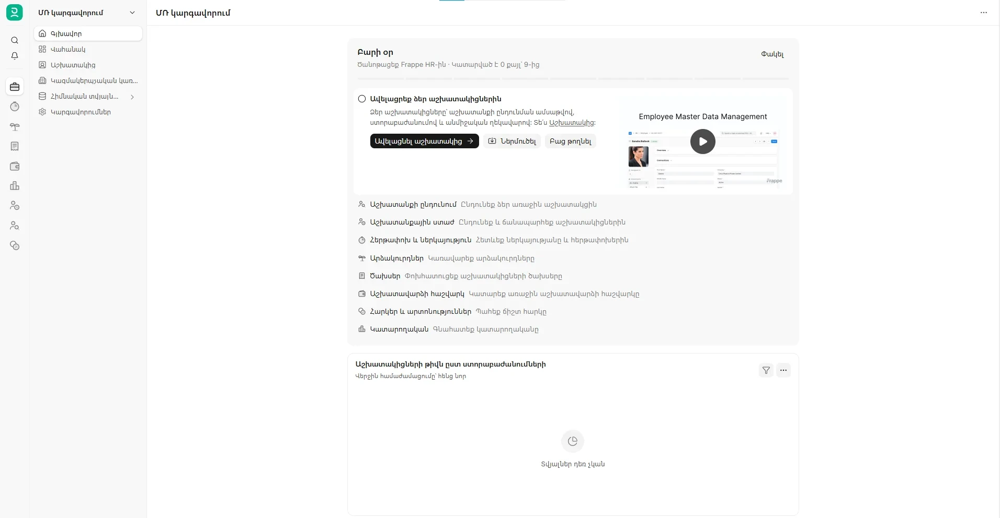
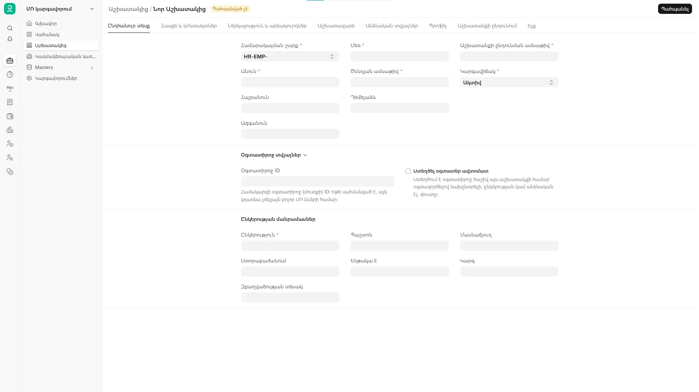

# ERPNext in Armenian

Armenian (`hy`) translation for Frappe, ERPNext and Frappe HR, version 16. It's a small Frappe app: install it, switch the language to Հայերեն, done. No changes to your data, no setup.

[Հայերեն](README.hy.md)

We needed ERPNext in Armenian, so we started this. Pretty much every string in v16 is covered now:

- Frappe: 7,907 of 7,909
- ERPNext: 10,858 of 10,860
- Frappe HR: 2,229 of 2,229

The handful left untranslated are on purpose. Things like `ALL` (the Albanian lek code), `JAN` (a barcode type) and `HERE` (a map provider) are codes, not words, and translating them breaks stuff.









## Getting it running

Pick whichever fits you. They all end up in the same place.

### 1. You already have ERPNext on a bench

```bash
cd frappe-bench
bench get-app https://github.com/nastaran-hasanloo/erpnext_armenian --branch version-16
bench --site your-site install-app erpnext_armenian
bench --site your-site clear-cache
```

That's it. Nothing else on your site changes, and you can remove it any time (see below).

### 2. You're on Frappe Cloud

Add the app to your bench group from its GitHub URL (`https://github.com/nastaran-hasanloo/erpnext_armenian`, branch `version-16`), deploy, then install it on your site from the site's Apps tab. You'll need a bench group of your own for this; the shared ones only allow Marketplace apps.

### 3. You use frappe_docker

Add one line to your `apps.json` and build your image as usual:

```json
[
  {"url": "https://github.com/frappe/erpnext", "branch": "version-16"},
  {"url": "https://github.com/frappe/hrms", "branch": "version-16"},
  {"url": "https://github.com/nastaran-hasanloo/erpnext_armenian", "branch": "version-16"}
]
```

Then `bench --site your-site install-app erpnext_armenian` inside the backend container.

### 4. You just want to see it

No ERPNext yet? The `docker` folder spins up a full test setup (ERPNext + Frappe HR + Armenian) on your own computer. All you need is [Docker Desktop](https://www.docker.com/products/docker-desktop/).

- Windows: download this repo as a ZIP, unzip it, double-click `docker/START-ERPNext-Armenian.bat`
- Linux or macOS: `git clone` this repo and run `./docker/erpnext-armenian.sh`

The first build takes a while, around 20 to 40 minutes. Then open http://localhost:8080 and log in as `Administrator` / `admin`. That password is only for playing around on your own machine.

To stop it: `STOP.bat` or `./erpnext-armenian.sh stop`. To pick up new translations: `UPDATE.bat` or `./erpnext-armenian.sh update`. To wipe it and start over: `RESET-delete-all-data.bat` or `./erpnext-armenian.sh reset`.

## Switching to Armenian

- Just for you: click your avatar, My Settings, set Language to Հայերեն, save, reload.
- For everyone by default: System Settings, Language, Հայերեն.
- On a brand new site you can simply pick Հայերեն in the setup wizard.

Each person can still pick their own language, so an English-speaking accountant and an Armenian-speaking warehouse team can work on the same site.

Installing the app also sets up Armenian formats: dates like `25.10.2026`, numbers like `1 234,56`, and weeks starting on Monday. If you had already picked other formats, those are left alone.

## Updating

```bash
bench update --apps erpnext_armenian
bench --site your-site clear-cache
```

## Removing it

```bash
bench --site your-site uninstall-app erpnext_armenian
bench remove-app erpnext_armenian
```

Your data isn't touched. The interface simply goes back to English (or whatever language you had).

## If something looks wrong

- Installing says your Frappe version doesn't match? Use the branch for your version. Only v16 is out for now; v15 is coming.
- Still seeing English after installing? Run `bench --site your-site clear-cache` and reload the page with Ctrl+Shift+R. Browsers hold on to old translations.
- A few things stay in English on purpose: names you or the setup created as records (departments, roles, print formats), and codes like currency symbols.
- Found a screen with English text that should be translated? Open an issue with a screenshot. Usually it's a string upstream doesn't mark for translation, and we can add it here.

## Versions

Only `version-16` for now. A `version-15` branch is next on the list.

## How it's put together

Frappe picks up `locale/<lang>.po` from every installed app and merges them, so this app only ships one file: `erpnext_armenian/locale/hy.po`. It gets built from these:

```
translations/frappe/hy.po      frappe strings
translations/erpnext/hy.po     erpnext strings
translations/hrms/hy.po        hrms strings
translations/overrides/hy.po   our fixes, plus strings missing from upstream
translations/glossary-hy.json  the accounting terms we stick to
```

The per-app files use the same layout as upstream, so they can go straight to the [Frappe project on Crowdin](https://crowdin.com/project/frappe).

One thing that confuses people: names that get created as data (default departments, roles, print format names and so on) live in the database, so a UI translation won't change them.

## A heads-up

The first pass was done with translation tools and a fixed glossary, then checked by hand. It's usable, but some wording will feel off to a native speaker, especially accounting terms. Please have someone who knows Armenian accounting look it over before you rely on it in production.

Also, this is only the interface. Armenian VAT, SRC e-invoices, payroll, the Armenian chart of accounts and local banks aren't in here yet.

## Helping out

If you speak Armenian and something reads weird, please fix it. Accountants and people who use ERPNext every day are especially welcome. [CONTRIBUTING.md](CONTRIBUTING.md) has the details.

## License

GPL-3.0-or-later, same as ERPNext. The Docker files are based on [frappe_docker](https://github.com/frappe/frappe_docker) (MIT, license in `docker/resources/LICENSE-frappe_docker`).
